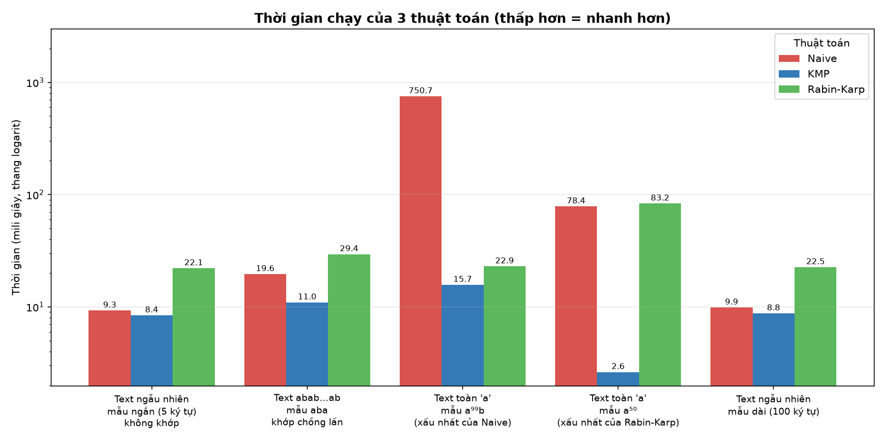
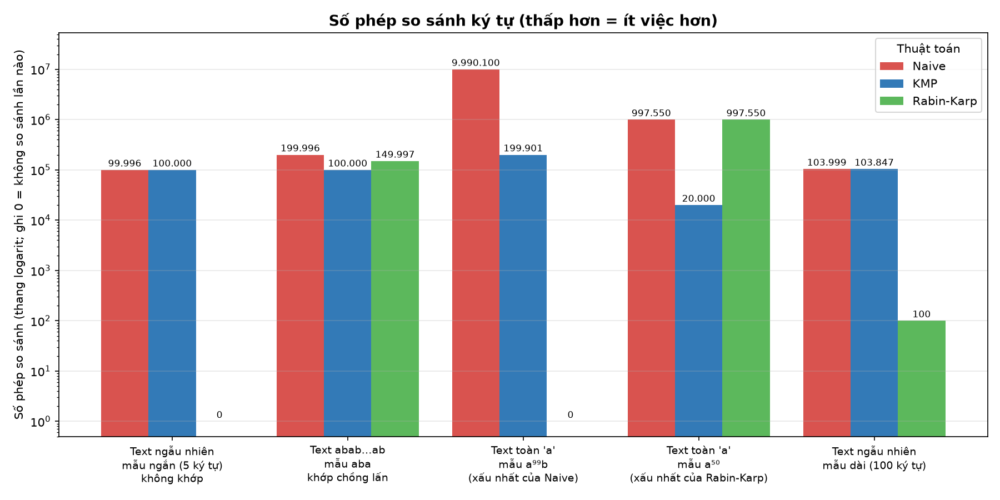

# So sánh 3 thuật toán tìm kiếm chuỗi

Đo trên máy thật, Python; thời gian là nhỏ nhất của 3 lần chạy. **In đậm = nhanh nhất / ít phép so sánh nhất.**

## Bảng 1. Thời gian chạy (mili giây, càng nhỏ càng tốt)

| Tình huống | Độ dài văn bản | Độ dài mẫu | Số vị trí khớp | Naive (duyệt trâu) | KMP | Rabin-Karp |
|---|--:|--:|--:|--:|--:|--:|
| Văn bản ngẫu nhiên, mẫu không có trong văn bản | 100.000 | 5 | 0 | 9.3 | **8.4** | 22.1 |
| Văn bản abab…ab, mẫu aba (khớp chồng lấn liên tục) | 100.000 | 3 | 49.999 | 19.6 | **11.0** | 29.4 |
| Văn bản toàn chữ a, mẫu aaa…ab (99 chữ a + b) | 100.000 | 100 | 0 | 750.7 | **15.7** | 22.9 |
| Văn bản toàn chữ a, mẫu 50 chữ a (khớp ở mọi vị trí) | 20.000 | 50 | 19.951 | 78.4 | **2.6** | 83.2 |
| Văn bản ngẫu nhiên 26 chữ cái, mẫu dài 100 ký tự | 100.000 | 100 | 1 | 9.9 | **8.8** | 22.5 |

## Bảng 2. Số phép so sánh ký tự (càng nhỏ càng tốt)

| Tình huống | Naive (duyệt trâu) | KMP | Rabin-Karp |
|---|--:|--:|--:|
| Văn bản ngẫu nhiên, mẫu không có trong văn bản | 99.996 | 100.000 | **0** |
| Văn bản abab…ab, mẫu aba (khớp chồng lấn liên tục) | 199.996 | **100.000** | 149.997 |
| Văn bản toàn chữ a, mẫu aaa…ab (99 chữ a + b) | 9.990.100 | 199.901 | **0** |
| Văn bản toàn chữ a, mẫu 50 chữ a (khớp ở mọi vị trí) | 997.550 | **20.000** | 997.550 |
| Văn bản ngẫu nhiên 26 chữ cái, mẫu dài 100 ký tự | 103.999 | 103.847 | **100** |

> Rabin-Karp chỉ so sánh ký tự khi hash trùng, nên số phép so sánh có thể rất nhỏ (thậm chí 0) dù vẫn phải tính hash ở mọi vị trí; vì vậy cần đối chiếu cả hai bảng.

## Vì sao chọn các tình huống này

| Tình huống | Thuộc nhóm của đề bài | Lý do chọn |
|---|---|---|
| Văn bản ngẫu nhiên, mẫu không có trong văn bản | Văn bản dài, mẫu ngắn | Trường hợp thông thường nhất: tìm một từ ngắn trong văn bản dài |
| Văn bản abab…ab, mẫu aba (khớp chồng lấn liên tục) | Văn bản lặp lại | Văn bản và mẫu cùng lặp lại, có rất nhiều vị trí khớp |
| Văn bản toàn chữ a, mẫu aaa…ab (99 chữ a + b) | Văn bản lặp lại | Xấu nhất của Naive: mỗi vị trí so gần hết mẫu rồi mới lệch ở ký tự cuối |
| Văn bản toàn chữ a, mẫu 50 chữ a (khớp ở mọi vị trí) | Văn bản lặp lại | Xấu nhất của Rabin-Karp: hash luôn trùng nên lần nào cũng phải kiểm tra lại cả mẫu |
| Văn bản ngẫu nhiên 26 chữ cái, mẫu dài 100 ký tự | Văn bản và mẫu ngẫu nhiên | Dữ liệu ngẫu nhiên với mẫu dài |
