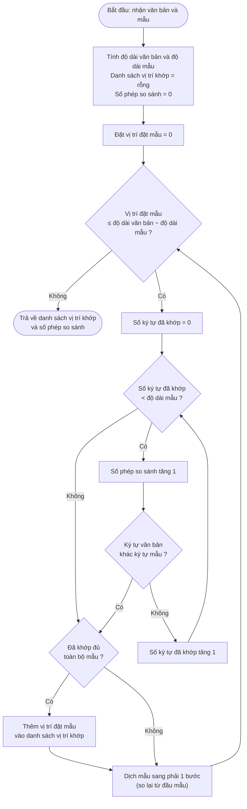
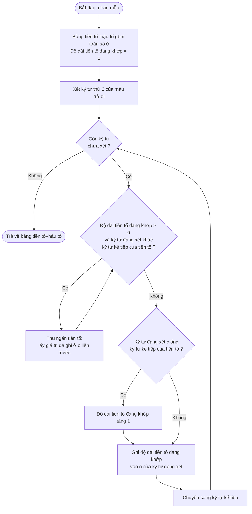
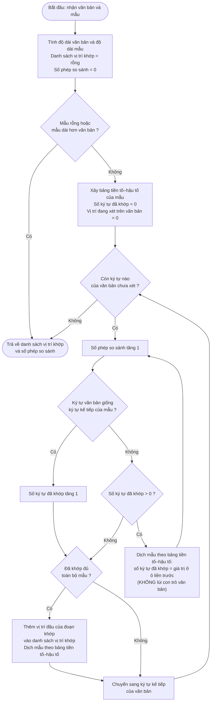
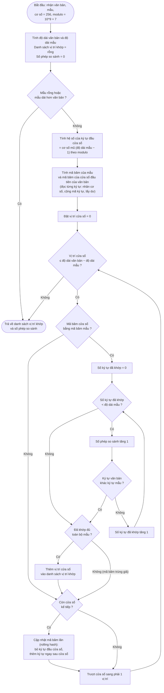

# Lưu đồ 3 thuật toán tìm kiếm chuỗi

Dựa trên cài đặt thực trong `thuat_toan/naive.py`, `thuat_toan/kmp.py`, `thuat_toan/rabin_karp.py`.
Cả 3 thuật toán đều trả về: danh sách vị trí khớp và số phép so sánh ký tự.

## 1. Thuật toán duyệt trâu (Naive), độ phức tạp O(n·m)

## 2. Thuật toán Knuth-Morris-Pratt (KMP), độ phức tạp O(n + m)

### 2a. Xây bảng tiền tố – hậu tố

### 2b. Tìm kiếm bằng KMP

## 3. Thuật toán Rabin-Karp, trung bình O(n + m), xấu nhất O(n·m)

## So sánh nhanh

| Thuật toán | Ý tưởng | Con trỏ văn bản | Độ phức tạp |
|---|---|---|---|
| Duyệt trâu | Thử mọi vị trí, so từ đầu mẫu | Quay lại khi lệch (dịch mẫu 1 bước, so lại từ đầu mẫu) | O(n·m) |
| KMP | Dùng bảng tiền tố–hậu tố để dịch mẫu thông minh | Không bao giờ lùi | O(n + m) |
| Rabin-Karp | So mã băm trước, chỉ so ký tự khi mã băm trùng | Trượt cửa sổ bằng mã băm lăn | Trung bình O(n + m), xấu nhất O(n·m) |
